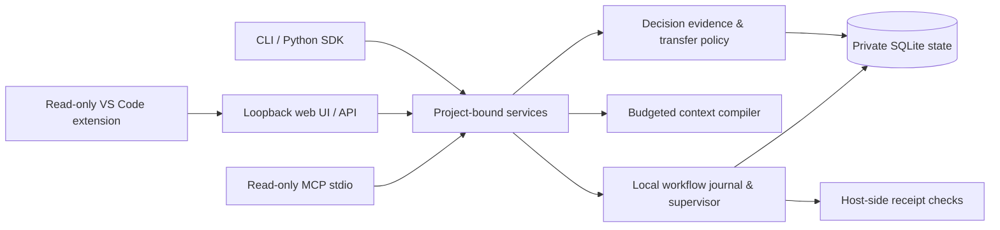

# DecisionBound

**Evidence-grounded engineering decisions and bounded agent workflows.**

[](https://github.com/ahmedjawedaj/decisionbound/actions/workflows/ci.yml)
[](https://github.com/ahmedjawedaj/decisionbound/actions/workflows/quality-gate.yml)
[](https://github.com/ahmedjawedaj/decisionbound/actions/workflows/platform-certification.yml)
[](https://ahmedjawedaj.github.io/decisionbound/)
[](pyproject.toml)
[](LICENSE)
[](CHANGELOG.md)
[](#citation)

[Documentation](https://ahmedjawedaj.github.io/decisionbound/) · [Interactive demo](https://ahmedjawedaj.github.io/decisionbound/concept/) · [Quickstart](https://ahmedjawedaj.github.io/decisionbound/getting-started.html) · [API reference](https://ahmedjawedaj.github.io/decisionbound/api-reference.html) · [Roadmap](ROADMAP.md) · [Issues](https://github.com/ahmedjawedaj/decisionbound/issues) · [Discussions](https://github.com/ahmedjawedaj/decisionbound/discussions)

DecisionBound is a local-first Python SDK and CLI for recording engineering decisions with their source evidence, checking whether those decisions apply in another repository, and coordinating bounded agent work with explicit permissions and verifiable receipts.

It connects decision provenance, conservative context transfer, local workflow coordination, and consent-bound coding/review in one developer toolkit. CLI, web, editor, and MCP surfaces share project identities and local state.

> **Experimental alpha — package version `0.13.0a1`.** Local functionality is implemented, but this is not a production-certified autonomous service. The full test suite runs on Linux, macOS and Windows in CI, and independent security review remains incomplete. Badges show actual workflow status; passing checks does not certify every platform or integration.

### At a glance

```bash
git clone https://github.com/ahmedjawedaj/decisionbound.git && cd decisionbound
python -m pip install -e '.[web]'

cd /path/to/your/repository
dbound setup --profile local-safe --path . --initialize      # register this project locally
dbound doctor --path . --strict                              # check prerequisites, nonzero exit if missing
dbound agent demo "Find the relevant module" --path .        # deterministic agent run, no model call
dbound prepare "Review the error-handling path" --path . --tokens 1200   # budgeted context capsule
```

This path is fully offline: no model account, API key or network request. See [Installation](#installation) and [Quickstart](#quickstart) for the full walk-through.

## Contents

- [Why DecisionBound?](#why-decisionbound)
- [Capabilities and boundaries](#capabilities-and-boundaries)
- [Documentation and demo](#documentation-and-demo)
- [Installation](#installation)
- [Quickstart](#quickstart)
- [Python SDK](#python-sdk)
- [Examples](#examples)
- [Workflows and developer clients](#workflows-and-developer-clients)
- [Architecture](#architecture)
- [Security and data handling](#security-and-data-handling)
- [Verification and development](#verification-and-development)
- [Evaluation and roadmap](#evaluation-and-roadmap)
- [Repository structure](#repository-structure)
- [Related projects](#related-projects)
- [Contributing and support](#contributing-and-support)
- [License and citation](#license-and-citation)
  - [Citation](#citation)

## Why DecisionBound?

An engineering decision can be useful in one project and inappropriate in another. A merged patch, retrieved document, or model response does not by itself establish that a rule is applicable, approved, or safe to execute.

DecisionBound makes those distinctions explicit:

1. **Keep the evidence.** Decisions reference source documents and SHA-256 fingerprints. Discovery creates a candidate; approval requires a separate review of unchanged evidence.
2. **Check the target.** Scope, ownership, technology tags, exclusions, and forbidden decisions constrain reuse. Outcomes are `apply`, `translate`, `abstain`, or `escalate`.
3. **Bound the context.** The compiler selects context within a token budget. Protected requirements must fit; they cannot be silently discarded.
4. **Separate execution from verification.** Worker results, test receipts, contract checks, and local export approval represent different kinds of evidence. A model cannot grant itself permission or declare a task verified.
5. **Recover conservatively.** Workflow journals, leases, heartbeats, and recovery records track local progress across interruptions. Uncertain writes require reconciliation rather than automatic replay.

Typical uses include maintaining reviewed architecture decisions, previewing cross-project reuse, inspecting repositories through bounded read-only tools, experimenting with local workflow supervision, and reviewing explicitly authorized patch candidates.

## Capabilities and boundaries

| Area | Available in the public alpha | Boundary |
| --- | --- | --- |
| Decision records | ADR discovery, evidence fingerprints, approval revisions, conservative transfer | Retrieved text and identifiers do not grant authority |
| Context compilation | Budgeted selection, protected items, source pointers | Default selection is a baseline, not a proven semantic ranking system |
| Read-only agent execution | Deterministic demo, strict model/tool JSON contracts, optional provider adapters, budgets and receipts | Remote calls require explicit configuration and consent |
| Coding and review | Patch validation, disposable Git worktrees, acceptance contracts, bounded repair and patch-export review | Writes and Docker execution require authorization; no automatic merge or push |
| Local orchestration | Dependency graphs, SQLite claims, supervisor/worker dispatch, leases, heartbeats and recovery | Single-device coordination; no distributed consensus. Optional contained workers add hard deadlines and process-tree termination (tests run in CI on Linux, macOS and Windows), but they are not a security sandbox |
| State durability | Integrity checks, consistent backups, non-overwriting restore and explicit schema migration | Backups contain private metadata; no cross-device replication |
| Local web interface | Authenticated loopback API, session inspection and local review controls | Single-user pairing; do not expose it as a public service |
| VS Code extension | Read-only sessions, events, pairing and setup diagnostics | Source and host/packaging checks are provided; Marketplace availability is not implied |
| MCP | Optional official-SDK v2 read-only stdio server for a verified project | No general remote MCP endpoint or write-capable MCP tools |
| Release tooling | Wheel builds, source/Pages archives, manifests, checksums and verification helpers | Archive integrity alone does not establish publisher authenticity |

See [SECURITY.md](SECURITY.md), the [production-readiness guide](https://ahmedjawedaj.github.io/decisionbound/production-readiness.html), and exact-commit [Actions results](https://github.com/ahmedjawedaj/decisionbound/actions) for limitations and evidence.

## Documentation and demo

The [documentation site](https://ahmedjawedaj.github.io/decisionbound/) contains installation instructions, feature guides, public contracts, and a source-generated API reference. Markdown sources live under [`site_docs/`](site_docs/).

| Guide | Purpose |
| --- | --- |
| [Getting started](https://ahmedjawedaj.github.io/decisionbound/getting-started.html) | Initialize a project, discover evidence and prepare a task |
| [Setup and diagnostics](https://ahmedjawedaj.github.io/decisionbound/setup-diagnostics.html) | Select a profile and check local prerequisites |
| [CLI reference](https://ahmedjawedaj.github.io/decisionbound/cli.html) | Commands, options and their side effects |
| [Python SDK](https://ahmedjawedaj.github.io/decisionbound/sdk.html) · [API reference](https://ahmedjawedaj.github.io/decisionbound/api-reference.html) | Integrate the core and implement extension ports |
| [Agent execution](https://ahmedjawedaj.github.io/decisionbound/agent-execution.html) | Read-only tools, providers, budgets and result semantics |
| [Coding agents](https://ahmedjawedaj.github.io/decisionbound/coding-agents.html) · [Repair loops](https://ahmedjawedaj.github.io/decisionbound/repair-loops.html) | Authorized patch and acceptance-contract workflows |
| [Orchestration](https://ahmedjawedaj.github.io/decisionbound/orchestration.html) · [Background service](https://ahmedjawedaj.github.io/decisionbound/durable-service.html) | Local graphs, supervision, leases and recovery |
| [Patch review](https://ahmedjawedaj.github.io/decisionbound/review-console.html) | Inspect, approve and export an exact patch snapshot |
| [Local clients and VS Code](https://ahmedjawedaj.github.io/decisionbound/local-clients.html) · [MCP](https://ahmedjawedaj.github.io/decisionbound/mcp-integration.html) | Connect supported developer surfaces |
| [State recovery](https://ahmedjawedaj.github.io/decisionbound/state-recovery.html) · [Schema upgrades](https://ahmedjawedaj.github.io/decisionbound/schema-upgrades.html) | Inspect, back up and migrate local state |
| [Sandboxing](https://ahmedjawedaj.github.io/decisionbound/sandboxing.html) · [Verification](https://ahmedjawedaj.github.io/decisionbound/verification.html) | Understand containment and evidence boundaries |
| [Release verification](https://ahmedjawedaj.github.io/decisionbound/release-verification.html) | Inspect package integrity and signing-related contracts |

### Interactive concept demo

**[Open the demo →](https://ahmedjawedaj.github.io/decisionbound/concept/)**

Explore compatible context, conflicting project policy, and security constraints using synthetic scenarios and an illustrative context-budget slider. The demo is deterministic: it does not call a model, analyze your repository, execute code, or establish a benchmark result. GitHub Pages hosts static documentation and this simulation; the agent backend runs locally.

## Installation

### Prerequisites

- **Python 3.11 or newer** for the SDK and CLI.
- **Git** for source installation and isolated coding worktrees.
- **Node.js 22** for extension and demo development checks.
- **Docker**, a reviewed local image, and explicit consent when using real container-based coding tests.

The default offline path needs no model account or API key. This guide installs from source and does not assume a published PyPI package or editor Marketplace release.

### Clone and create an environment

Commands use `python`; use your Python 3.11+ executable (`python3` or `py -3`) where appropriate.

```bash
git clone https://github.com/ahmedjawedaj/decisionbound.git
cd decisionbound
python -m venv .venv
```

Activate on macOS/Linux:

```bash
source .venv/bin/activate
```

Or in Windows PowerShell:

```powershell
.venv\Scripts\Activate.ps1
```

Install the SDK, CLI and optional local web interface:

```bash
python -m pip install -e '.[web]'
dbound --help
```

### Optional dependencies

| Extra | Enables | Install from the repository root |
| --- | --- | --- |
| Base | SDK and CLI | `python -m pip install -e .` |
| `web` | Local FastAPI/Uvicorn interface | `python -m pip install -e '.[web]'` |
| `mcp` | Official MCP v2 SDK integration | `python -m pip install -e '.[mcp]'` |
| `docs` | Static documentation generation | `python -m pip install -e '.[docs]'` |
| `test` | Python test and coverage tools | `python -m pip install -e '.[test]'` |
| `release` | Release verification dependencies | `python -m pip install -e '.[release]'` |
| Development | All of the above | `python -m pip install -e '.[test,web,docs,release,mcp]'` |

## Quickstart

### 1. Register a project explicitly

In the repository you want to inspect:

```bash
cd /path/to/your/repository
dbound setup --profile local-safe --path . --initialize
dbound doctor --path . --strict
dbound status --path .
```

Initialization creates a local project manifest and registers it in your local state store. A profile does not grant provider access, coding permissions, or a security certification. `doctor --strict` exits nonzero when required prerequisites are missing.

### 2. Try the offline path

```bash
dbound agent demo "Find the relevant module" --path .
dbound prepare "Review the error-handling path" --path . --tokens 1200
dbound transfer --path .
dbound run "Review the error-handling path" --path .
```

`agent demo` uses deterministic model-shaped responses. `prepare` builds a context capsule; `transfer` previews reuse decisions. The offline `run` command performs preparation and records its trace—it does not implement a requested code change. Preparation success remains distinct from overall task completion.

### 3. Discover and approve a decision

Create an ADR with nonempty `## Context` and `## Decision` sections, then inspect it:

```bash
dbound decision discover docs/adr/0001-domain-boundaries.md --path .
dbound decision list --path .
```

After reviewing the evidence, use the actual decision ID and revision returned by the CLI:

```bash
dbound decision approve DECISION_ID --revision REVISION --path .
```

`DECISION_ID` and `REVISION` are placeholders. Approval checks that the evidence still matches its fingerprint. If the source changes, rediscover and review it. Project-scoped decisions stay within their source project; cross-project reuse is constrained by the transfer policy.

## Python SDK

The core exposes data contracts and replaceable ports, including `DecisionRepository`, `TransferPolicy`, `ContextCompiler`, `AgentWorker`, and workflow interfaces. Applications can inject adapters while retaining host-enforced authority checks.

This example creates temporary local state, discovers an ADR, explicitly approves its unchanged evidence, and prepares a context capsule:

```python
from pathlib import Path
from tempfile import TemporaryDirectory

from decisionbound import SQLiteRepository
from decisionbound.identity import init_project
from decisionbound.services import DecisionService

with TemporaryDirectory() as directory:
    workspace = Path(directory) / "example-project"
    workspace.mkdir()
    store = SQLiteRepository(Path(directory) / "state" / "state.sqlite3")
    project = init_project(workspace, store, name="example-project",
                           technologies=("python",))

    (workspace / "architecture.md").write_text(
        "# Domain boundaries\n\n"
        "## Context\nKeep transport logic easy to test.\n\n"
        "## Decision\nKeep handlers thin and isolate domain rules.\n",
        encoding="utf-8",
    )

    service = DecisionService(store)
    candidate = service.discover_adr(project, workspace, "architecture.md")
    # This approval is an explicit application/operator decision.
    service.approve(workspace, candidate.decision_id, candidate.revision)
    capsule = service.prepare("Inspect domain boundaries", project,
                              max_tokens=1200)
    print(capsule.to_dict())
```

See [`examples/custom_policy.py`](examples/custom_policy.py), the [SDK guide](https://ahmedjawedaj.github.io/decisionbound/sdk.html), and the [API reference](https://ahmedjawedaj.github.io/decisionbound/api-reference.html) for extension contracts. A custom adapter cannot bypass canonical project identity, evidence checks, or write authorization.

## Examples

The [`examples/`](examples/) folder has runnable scripts. Each one creates its own temporary project, needs no network, credentials or Docker, and prints what it checked. Run them from the repository root after the editable install.

| Example | Shows |
| --- | --- |
| [`custom_policy.py`](examples/custom_policy.py) | A team transfer policy that adds a veto on top of the conservative core rules |
| [`mock_readonly_agent.py`](examples/mock_readonly_agent.py) | A deterministic read-only repository inspection, and that tool receipts cannot claim task completion |
| [`mock_patch_agent.py`](examples/mock_patch_agent.py) | The coding lifecycle in a disposable worktree, with the original checkout left untouched |
| [`mock_repair_agent.py`](examples/mock_repair_agent.py) | A bounded repair loop: one failing fake test, a second patch, and no change to source files |

```bash
python examples/custom_policy.py
python examples/mock_readonly_agent.py
```

Mock results show the lifecycle and integrity checks. They are never counted as real test success or verification.

Workflow manifests in [`examples/workflow/`](examples/workflow/) can be checked without running them:

| Manifest | Describes |
| --- | --- |
| [`repository-review.yaml`](examples/workflow/repository-review.yaml) | A fully offline, read-only review graph |
| [`mock-orchestration.yaml`](examples/workflow/mock-orchestration.yaml) | A multi-task graph with simulated outcomes and a zero cost budget |
| [`supervised-code-review.yaml`](examples/workflow/supervised-code-review.yaml) | A supervised review graph whose submission alone enables no coding, network or writes |

```bash
dbound workflow validate --file examples/workflow/mock-orchestration.yaml
```

## Workflows and developer clients

### Local workflow coordination

Example graph manifests live in [`examples/workflow/`](examples/workflow/). From the DecisionBound source checkout, validate one without executing it:

```bash
dbound workflow validate --file examples/workflow/repository-review.yaml
```

Submit a reviewed graph against an initialized project using `dbound workflow submit`, then inspect its returned ID with `dbound workflow status` and `dbound workflow events`. The convenience runner dispatches offline preparation and synthetic workers. Model-backed inspection and coding workers require explicit SDK configuration and authorization.

The coordinator supports leadership leases, heartbeat renewal, queue polling, conservative restart handling, and a low-resource preset. It does not provide multi-host consensus, multi-day endurance certification, or a hard execution deadline for arbitrary worker processes. See the [background-service guide](https://ahmedjawedaj.github.io/decisionbound/durable-service.html).

### Local web interface and VS Code

With the `web` extra installed:

```bash
dbound serve --host 127.0.0.1 --port 8765
```

Open `http://127.0.0.1:8765` and follow the pairing instructions. Use `dbound client pair --show-token` only when you intentionally need the local pairing token; treat it as a credential.

The web interface and [`apps/vscode/`](apps/vscode/) extension share project-scoped sessions and events. The extension is read-only. Local browser review controls can record explicit patch-export decisions; they do not apply patches, merge, push, or execute coding workers. See [local clients](https://ahmedjawedaj.github.io/decisionbound/local-clients.html) and [patch review](https://ahmedjawedaj.github.io/decisionbound/review-console.html).

### Read-only MCP integration

With the `mcp` extra installed, an authorized MCP host can start the project-bound stdio server:

```bash
dbound mcp serve --path /path/to/your/initialized/repository
```

The host must support the installed SDK/protocol. Tools are read-only and bound to the verified project. Consult the [MCP guide](https://ahmedjawedaj.github.io/decisionbound/mcp-integration.html) before configuring a client; a stdio server implementation does not establish compatibility with every external host.

## Architecture



Interfaces share application contracts rather than running separate agent engines. The default repository is SQLite; alternative repositories, policies, compilers, workers and transports must preserve public contracts and host checks. The [architecture guide](https://ahmedjawedaj.github.io/decisionbound/architecture.html) and [`src/decisionbound/`](src/decisionbound/) provide implementation detail.

## Security and data handling

- **Local state:** project manifests live under `.decisionbound/` in the selected workspace; the default user state directory is `~/.decisionbound/`. Tokens, databases, backups and private event data belong outside version control.
- **Explicit remote access:** provider requests require configuration, credentials, consent and cost assumptions. An active profile does not authorize a network request or source write.
- **Untrusted inputs:** documents, skills, model outputs and tool descriptions are data. They cannot elevate themselves into host policy or grant capabilities.
- **Bounded inspection:** source tools enforce project/path and file restrictions. Those checks are not an OS sandbox, and permitted source files may contain sensitive information.
- **Coding permissions:** patch scope, contracts, source identity, isolated worktrees and runner receipts are checked separately. Mocked tests cannot establish real sandbox verification.
- **Conservative recovery:** uncertain write outcomes are blocked for reconciliation. Restores and migrations create separate state files rather than replacing an active database automatically.
- **Public distribution:** [`PUBLIC_CONTENT.json`](PUBLIC_CONTENT.json) lists reviewed files. Public changes and packages are checked against that allowlist; private notes, drafts, raw logs and runtime state are excluded.

Read [SECURITY.md](SECURITY.md) before using the alpha with sensitive repositories. Report vulnerabilities through [private vulnerability reporting](https://github.com/ahmedjawedaj/decisionbound/security/advisories/new), without posting credentials or confidential code in public issues.

## Verification and development

Install development extras, then run relevant checks from the source root:

```bash
python -m pip install -e '.[test,web,docs,release,mcp]'
python -m pytest -q --cov=decisionbound --cov-fail-under=80
python scripts/check_publication.py
node --test tests/site-demo.test.mjs
```

Extension source and contract checks:

```bash
cd apps/vscode
npm run check
npm test
```

Build and verify documentation from the repository root:

```bash
python scripts/generate_api_docs.py
python scripts/build_site.py
python scripts/verify_docs.py
python scripts/check_docs.py
```

Build a matching wheel before checking archive reproducibility:

```bash
python -m pip wheel . --no-deps --wheel-dir dist
python scripts/release_roundtrip.py
```

| Workflow | Evidence it collects |
| --- | --- |
| [Runtime and integration CI](https://github.com/ahmedjawedaj/decisionbound/actions/workflows/ci.yml) | Python/OS matrix, coverage, actual MCP, browser/HTTP, Docker, editor-host and packaging checks |
| [Release readiness](https://github.com/ahmedjawedaj/decisionbound/actions/workflows/quality-gate.yml) | Linux regressions with MCP, public-content boundary, docs/demo/extension checks and reproducible packages |
| [Installed platform checks](https://github.com/ahmedjawedaj/decisionbound/actions/workflows/platform-certification.yml) | Built-wheel installation and real local transport/editor-host checks on configured operating systems |
| [Documentation deployment](https://github.com/ahmedjawedaj/decisionbound/actions/workflows/pages.yml) | Static documentation built from the exact main commit that passed release readiness |

Some integrations require opt-in prerequisites. A skipped test is not a pass, mocked HTTP is not browser-to-server evidence, and an installed-wheel smoke check is narrower than a full regression suite. Inspect the results for the commit you intend to use; no static test count in this README substitutes for current CI. Required checks must pass before merging.

## Evaluation and roadmap

[`benchmarks/transferbench/`](benchmarks/transferbench/) (public name: CarryBench, synthetic tier) contains synthetic fixtures and a deterministic policy-oracle runner. It compares fixed transfer policies against handcrafted action labels. It does not execute software tasks through an LLM, measure real provider cost, or establish generalization to production repositories. See the [evaluation guide](https://ahmedjawedaj.github.io/decisionbound/transferbench-runner.html).

The public [roadmap](ROADMAP.md) prioritizes independently verified worker isolation and cancellation, platform correctness, security review, resource measurement and reproducible packaging. Distributed coordination, multi-host recovery and sustained fleet operation remain future work. No delivery date or comparative performance advantage is promised.

## Repository structure

```text
src/decisionbound/        SDK, CLI, policies, storage, workflows and adapters
apps/vscode/             Read-only editor extension and host tests
site_docs/               User guides and generated API documentation source
docs/                    Static illustrative demo assets
examples/                SDK examples and workflow manifests
schemas/                 Versioned data and execution contracts
config/                  Example configuration and profile presets
benchmarks/transferbench/ Synthetic policy fixtures and evaluation guidance
tests/                   Runtime, integration, security and contract tests
scripts/                 Documentation, packaging and verification tools
.github/                 CI, issue templates, ownership and dependency updates
PUBLIC_CONTENT.json      Reviewed public-file allowlist
```

The public repository contains product source and reviewed documentation. Operational notes, private datasets, unpublished drafts, credentials and runtime state are outside this distribution. See [PUBLICATION_POLICY.md](PUBLICATION_POLICY.md).

## Related projects

DecisionBound reads decision records rather than authoring them. It pairs with existing ADR tooling:

- [adr-tools](https://github.com/npryce/adr-tools) creates and links ADRs from the command line. Its default template uses the `## Context` and `## Decision` headings that `dbound decision discover` expects.
- [MADR](https://github.com/adr/madr) is a Markdown ADR template. Its default headings differ, so include `## Context` and `## Decision` sections in records you want DecisionBound to discover.
- [Log4brains](https://github.com/thomvaill/log4brains) manages and publishes ADRs as a browsable site.
- [adr.github.io](https://adr.github.io/) collects ADR background, templates and tools.

### Related work on decision memory for coding agents

DecisionBound is not the first tool or benchmark in this space. These are the closest items found in a primary-source review on 2026-11-16, listed so you can compare. Descriptions are brief and may be incomplete.

- [Mneme](https://github.com/mnemehq/mneme) keeps decision records with status, priority and scope for coding agents, and ships a small applicability benchmark.
- [archgate](https://github.com/archgate/cli) turns architecture decisions into checks that can run in CI.
- [ManyIH-Bench](https://arxiv.org/html/2604.09443v2) tests how models resolve conflicting instructions across many priority tiers.
- [Memory Transfer Learning](https://arxiv.org/pdf/2604.14004) studies how memories move across domains in coding agents, including cases where they hurt.
- [VibeMemBench](https://arxiv.org/html/2609.23570) compares memory systems for coding agents on real repositories.
- [COUNTERMEM](https://arxiv.org/abs/2609.31874) studies verified corrections and when an agent should skip memory.

What this project adds is narrower than any of these on its own: cross-repository reuse of human-approved decisions with an explicit apply, translate, abstain or escalate response. That combination has no real-repository benchmark yet. The bundled fixtures are synthetic and cannot support outside claims.

For agent hosts, the read-only server follows the [Model Context Protocol](https://modelcontextprotocol.io/) and uses the [official MCP Python SDK](https://github.com/modelcontextprotocol/python-sdk) through the optional `mcp` extra.

## Contributing and support

- Follow [CONTRIBUTING.md](CONTRIBUTING.md) for setup, scoped changes, verification and pull requests.
- Use [Issues](https://github.com/ahmedjawedaj/decisionbound/issues) for reproducible bugs and focused proposals. Include the version/commit, OS and a minimal sanitized reproduction.
- Use [Discussions](https://github.com/ahmedjawedaj/decisionbound/discussions) for usage and architecture questions.
- Use [private vulnerability reporting](https://github.com/ahmedjawedaj/decisionbound/security/advisories/new) for sensitive security findings.
- Review [GOVERNANCE.md](GOVERNANCE.md) and the [Code of Conduct](CODE_OF_CONDUCT.md). The latest alpha/main checkpoint is maintained without a stable-release or response-time SLA.

## License and citation

Original DecisionBound material is licensed under [Apache License 2.0](LICENSE). See [NOTICE](NOTICE); third-party dependencies and datasets retain their own terms.

### Citation

If you use the software, cite the version or commit using [CITATION.cff](CITATION.cff). GitHub's **Cite this repository** feature reads that metadata. No DOI, peer-reviewed result, signed production release, PyPI publication, or Marketplace distribution is implied by the source repository.

```bibtex
@software{jawed2026decisionbound,
  author  = {Jawed, Ahmed},
  title   = {{DecisionBound}: Evidence-grounded engineering judgment for {AI} agents},
  year    = {2026},
  version = {0.13.0a1},
  license = {Apache-2.0},
  url     = {https://github.com/ahmedjawedaj/decisionbound},
  note    = {Experimental alpha. Please also record the commit you used.}
}
```
