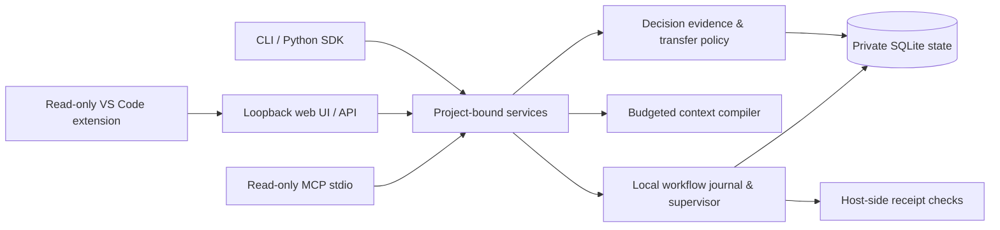

# DecisionBound

**Evidence-grounded engineering decisions and bounded agent workflows.**

[](https://github.com/ahmedjawedaj/decisionbound/actions/workflows/ci.yml)
[](https://github.com/ahmedjawedaj/decisionbound/actions/workflows/quality-gate.yml)
[](https://github.com/ahmedjawedaj/decisionbound/actions/workflows/platform-certification.yml)
[](https://ahmedjawedaj.github.io/decisionbound/)
[](pyproject.toml)
[](LICENSE)
[](CHANGELOG.md)
[](#citation)

[Documentation](https://ahmedjawedaj.github.io/decisionbound/) · [Quickstart](https://ahmedjawedaj.github.io/decisionbound/getting-started.html) · [Interactive concept demo](https://ahmedjawedaj.github.io/decisionbound/concept/) · [CarryBench](benchmarks/carrybench/README.md) · [Roadmap](ROADMAP.md) · [Issues](https://github.com/ahmedjawedaj/decisionbound/issues)

DecisionBound is a local-first Python library and CLI for one narrow question: **when a human has approved an engineering decision in one repository, what may an agent do with it in another?** It keeps the decision together with the file that justifies it (path and SHA-256), requires a separate approval step, and answers `apply`, `translate`, `abstain` or `escalate` for a target repository using explicit, deterministic rules. It then compiles the approved context within a token budget.

It is for developers building or running coding agents who want decisions to carry authority, evidence and limits, and for researchers studying when remembered decisions should not transfer. It is not an agent, a model, a code generator or a hosted service. The default path makes no model call, needs no account or API key and no network request.

> **Experimental alpha, version `0.13.0a1`.** The commands below work as shown. The transfer policy is a conservative rule set and has not been shown to beat simple baselines (see [Status](#status-and-evidence)). Nothing here is production certified or independently security reviewed. It is installed from source: there is no PyPI package and no editor Marketplace release.

## Install

Needs Python 3.11 or newer and Git.

```bash
git clone https://github.com/ahmedjawedaj/decisionbound.git
cd decisionbound
python -m venv .venv && source .venv/bin/activate   # Windows PowerShell: .venv\Scripts\Activate.ps1
python -m pip install .
dbound --help
```

In the verification run the install took about 7 seconds. Add `'.[web]'` instead of `.` only if you want the local web interface (`dbound serve`).

## 60-second demo

Run this in a bash or zsh shell, from an empty directory outside the clone, for example after `cd ..` (on Windows use Git Bash or WSL). It creates three tiny projects, records one decision with its evidence, approves it, and shows how the policy treats each project. `DBOUND_HOME` points the state at a throwaway folder, so nothing is written to your real `~/.decisionbound`. The script took about 3.5 seconds in the verification run.

<!-- quickstart:begin -->
```bash
mkdir dbound-demo && cd dbound-demo
export DBOUND_HOME="$PWD/state"   # throwaway state, nothing is written to ~/.decisionbound
mkdir -p shop/docs/adr blog acme

cat > shop/docs/adr/0001-thin-handlers.md <<'EOF'
# Thin handlers

## Context
HTTP code that held business rules was hard to test.

## Decision
Keep request handlers thin and put business rules in a separate module.
EOF

# 1. Record a decision with its evidence, then approve it as a human reviewer.
dbound init --path shop --name shop --owner ahmad --technologies python,django
dbound decision discover docs/adr/0001-thin-handlers.md --path shop --scope personal
ID=$(dbound decision list --path shop | python -c 'import json,sys; print(json.load(sys.stdin)[0]["decision_id"])')
dbound decision approve "$ID" --revision 1 --path shop

# 2. Ask what each repository may do with it.
dbound transfer --path shop                  # same project: apply
dbound init --path blog --name blog --owner ahmad --technologies python,flask
dbound transfer --path blog                  # same owner, compatible: translate
dbound init --path acme --name acme --owner someone-else --technologies python
dbound transfer --path acme                  # different owner: abstain

# 3. Compile the budgeted context a task would receive.
dbound prepare "Add a comments endpoint" --path blog --tokens 1200
```

Each `transfer` prints what that repository may do with the approved decision (identifiers differ on every run, and `sha256` is the hash of the ADR file above):

`shop`, the project the decision came from:

```json
[
  {
    "action": "apply",
    "decision_id": "dec_8727fde99ffe4d6fb90676790c251c41",
    "evidence_sha256": "d39cab7769e0d10b615f997e4ebf82c3c911fb89b74bbcf4f2d247fe3cdbc518",
    "reason": "Approved decision from the same project"
  }
]
```

`blog`, a different project with the same owner and compatible technology:

```json
[
  {
    "action": "translate",
    "decision_id": "dec_8727fde99ffe4d6fb90676790c251c41",
    "evidence_sha256": "d39cab7769e0d10b615f997e4ebf82c3c911fb89b74bbcf4f2d247fe3cdbc518",
    "reason": "Personal principle is compatible but needs target-repository adaptation"
  }
]
```

`acme`, a project with a different owner:

```json
[
  {
    "action": "abstain",
    "decision_id": "dec_8727fde99ffe4d6fb90676790c251c41",
    "evidence_sha256": "d39cab7769e0d10b615f997e4ebf82c3c911fb89b74bbcf4f2d247fe3cdbc518",
    "reason": "Personal decision owner differs from target owner"
  }
]
```

`prepare` then compiles the context a task in `blog` would receive, with the evidence hash attached:

```json
{
  "estimated_tokens": 24,
  "items": [
    {
      "key": "dec_8727fde99ffe4d6fb90676790c251c41",
      "priority": 10,
      "protected": false,
      "source": "docs/adr/0001-thin-handlers.md#sha256=d39cab7769e0d10b615f997e4ebf82c3c911fb89b74bbcf4f2d247fe3cdbc518",
      "text": "Keep request handlers thin and put business rules in a separate module."
    }
  ],
  "max_tokens": 1200,
  "omitted_keys": [],
  "task": "Add a comments endpoint"
}
```
<!-- quickstart:end -->

What this shows: a decision is evidence plus a human approval, and reuse across repositories is an explicit, explainable outcome that defaults to `abstain`. The decision is declared `--scope personal` so that it can leave its own project. A project-scoped decision never transfers, and `decision approve` fails if the evidence file changed since discovery. What it does not show: whether the decision is good, or whether a model follows it. `translate` means compatible but needs adapting by someone, and DecisionBound does not rewrite anything in the target repository.

Notes from running it. `approve --revision 1` returns revision `2`: discovery creates revision 1 as a candidate and approval records the next one. `dbound doctor --path . --strict` prints `"write_consent": false` as an informational check, because code writes always need a separate consent. It does not mean setup failed, and `"ready": true` is what counts.

Next: the [Quickstart](https://ahmedjawedaj.github.io/decisionbound/getting-started.html) registers your own repository with `dbound setup`, `dbound doctor` and your own ADRs. An ADR needs nonempty `## Context` and `## Decision` sections to be discovered.

## Status and evidence

- **Alpha.** The full Python test suite runs in CI on Linux, macOS and Windows. Some integrations (real Docker sandbox, real browser, editor host) are opt-in and skipped in a plain local run. A skipped test is not a pass. Check the [Actions results](https://github.com/ahmedjawedaj/decisionbound/actions) for the commit you use.
- **No demonstrated benefit yet.** [CarryBench](benchmarks/carrybench/README.md) is the benchmark built to test this idea. Its real-repository tier has 66 cases from 50 permissively licensed public repositories, plus a 35-case holdout whose labels were frozen before any system was scored on it. All labels come from two blind LLM annotators and **no human has labelled any case**, so scores measure agreement with that annotator pair, not correctness. On both sets DecisionBound's shipped policy behaves exactly like always abstaining in its default setting (0.348 and 0.371 accuracy). Its best setting scores 0.409 and 0.514, with intervals that overlap always abstaining. A simple rule that escalates authority topics and otherwise compares the target's strongest evidence scores higher (0.576 and 0.771), partly because it mirrors a rule in the annotation guide. On the first set, two guide-free language model runs score 0.59 and 0.68 but escalated to a human in only 1 and 3 of the 11 cases that needed one. These are small, unvalidated first numbers. They do not rank any product. See the [dataset card](benchmarks/carrybench/real_v1/DATASET_CARD.md), [baselines](benchmarks/carrybench/real_v1/BASELINE_RESULTS.md), [DecisionBound results](benchmarks/carrybench/real_v1/DECISIONBOUND_RESULTS.md) and the [holdout results](benchmarks/carrybench/real_v2_holdout/HOLDOUT_RESULTS.md).
- **Synthetic fixtures** under [`benchmarks/transferbench/`](benchmarks/transferbench/) test the policy's logic against handwritten labels. They say nothing about real repositories.
- **Boundaries.** Local single-device coordination only, no distributed consensus. Worker containment is not a security sandbox. The web interface and VS Code extension are loopback and read-only or review-only. MCP is a read-only stdio server. Provider calls need explicit configuration and consent. Read [SECURITY.md](SECURITY.md) before using it on a sensitive repository.

## What is in the box

| Area | What exists | Boundary |
| --- | --- | --- |
| Decision records | ADR discovery, evidence hashes, approval revisions, transfer policy | Retrieved text never grants authority |
| Context | Budgeted capsules with protected items and source pointers | A baseline selector, not a proven ranking system |
| Agent execution | Deterministic no-model demo, strict read-only tool contracts, optional provider adapters | Live providers are unverified |
| Coding and review | Patch validation, disposable worktrees, acceptance contracts, human-reviewed export | No automatic apply, merge or push |
| Orchestration | Local task graphs, leases, recovery, SQLite state backup and restore | Single device |
| Surfaces | CLI, Python SDK, loopback web UI, VS Code extension, MCP server | See each guide |

Guides: [CLI reference](https://ahmedjawedaj.github.io/decisionbound/cli.html), [Python SDK](https://ahmedjawedaj.github.io/decisionbound/sdk.html), [setup and diagnostics](https://ahmedjawedaj.github.io/decisionbound/setup-diagnostics.html), [agent execution](https://ahmedjawedaj.github.io/decisionbound/agent-execution.html), [coding agents](https://ahmedjawedaj.github.io/decisionbound/coding-agents.html), [orchestration](https://ahmedjawedaj.github.io/decisionbound/orchestration.html), [MCP](https://ahmedjawedaj.github.io/decisionbound/mcp-integration.html), [production readiness](https://ahmedjawedaj.github.io/decisionbound/production-readiness.html), [API reference](https://ahmedjawedaj.github.io/decisionbound/api-reference.html).



## Examples and development

From the repository root after installing, [`examples/`](examples/) has four offline scripts (`custom_policy.py`, `mock_readonly_agent.py`, `mock_patch_agent.py`, `mock_repair_agent.py`) and three workflow manifests you can check with `dbound workflow validate --file examples/workflow/repository-review.yaml`. Mock results show lifecycles and integrity checks, never real test success.

```bash
python -m pip install -e '.[test,web,docs,release,mcp]'
python -m pytest -q --cov=decisionbound --cov-fail-under=80
python scripts/check_publication.py
python scripts/generate_api_docs.py && python scripts/build_site.py
python scripts/verify_docs.py && python scripts/check_docs.py
```

`tests/integration/test_docs_quickstart.py` runs the demo above from the installed package and compares its output with the blocks pasted here, so this README cannot drift from the CLI. Extension checks are in `apps/vscode` (`npm run check && npm test`). The public file list is [`PUBLIC_CONTENT.json`](PUBLIC_CONTENT.json), see [PUBLICATION_POLICY.md](PUBLICATION_POLICY.md).

## Related projects

DecisionBound reads decision records rather than authoring them. It pairs with existing ADR tooling:

- [adr-tools](https://github.com/npryce/adr-tools) creates and links ADRs from the command line. Its default template uses the `## Context` and `## Decision` headings that `dbound decision discover` expects.
- [MADR](https://github.com/adr/madr) is a Markdown ADR template. Its default headings differ, so include `## Context` and `## Decision` sections in records you want DecisionBound to discover.
- [Log4brains](https://github.com/thomvaill/log4brains) manages and publishes ADRs as a browsable site.
- [adr.github.io](https://adr.github.io/) collects ADR background, templates and tools.

### Related work on decision memory for coding agents

DecisionBound is not the first tool or benchmark in this space. These are the closest items found in a primary-source review on 2026-11-16, listed so you can compare. Descriptions are brief and may be incomplete.

- [Mneme](https://github.com/mnemehq/mneme) keeps decision records with status, priority and scope for coding agents, and ships a small applicability benchmark.
- [archgate](https://github.com/archgate/cli) turns architecture decisions into checks that can run in CI.
- [ManyIH-Bench](https://arxiv.org/html/2604.09443v2) tests how models resolve conflicting instructions across many priority tiers.
- [Memory Transfer Learning](https://arxiv.org/pdf/2604.14004) studies how memories move across domains in coding agents, including cases where they hurt.
- [VibeMemBench](https://arxiv.org/html/2609.23570) compares memory systems for coding agents on real repositories.
- [COUNTERMEM](https://arxiv.org/abs/2609.31874) studies verified corrections and when an agent should skip memory.

What this project adds is narrower than any of these on its own: cross-repository reuse of human-approved decisions with an explicit apply, translate, abstain or escalate response. That combination has no real-repository benchmark yet. The bundled fixtures are synthetic and cannot support outside claims.

For agent hosts, the read-only server follows the [Model Context Protocol](https://modelcontextprotocol.io/) and uses the [official MCP Python SDK](https://github.com/modelcontextprotocol/python-sdk) through the optional `mcp` extra.

## Contributing and support

- Follow [CONTRIBUTING.md](CONTRIBUTING.md) for setup, scoped changes, verification and pull requests.
- Use [Issues](https://github.com/ahmedjawedaj/decisionbound/issues) for reproducible bugs and focused proposals. Include the version/commit, OS and a minimal sanitized reproduction.
- Use [Discussions](https://github.com/ahmedjawedaj/decisionbound/discussions) for usage and architecture questions.
- Use [private vulnerability reporting](https://github.com/ahmedjawedaj/decisionbound/security/advisories/new) for sensitive security findings.
- Review [GOVERNANCE.md](GOVERNANCE.md) and the [Code of Conduct](CODE_OF_CONDUCT.md). The latest alpha/main checkpoint is maintained without a stable-release or response-time SLA.

## License and citation

Original DecisionBound material is licensed under [Apache License 2.0](LICENSE). See [NOTICE](NOTICE); third-party dependencies and datasets retain their own terms.

### Citation

If you use the software, cite the version or commit using [CITATION.cff](CITATION.cff). GitHub's **Cite this repository** feature reads that metadata. No DOI, peer-reviewed result, signed production release, PyPI publication, or Marketplace distribution is implied by the source repository.

```bibtex
@software{jawed2026decisionbound,
  author  = {Jawed, Ahmed},
  title   = {{DecisionBound}: Evidence-grounded engineering judgment for {AI} agents},
  year    = {2026},
  version = {0.13.0a1},
  license = {Apache-2.0},
  url     = {https://github.com/ahmedjawedaj/decisionbound},
  note    = {Experimental alpha. Please also record the commit you used.}
}
```
